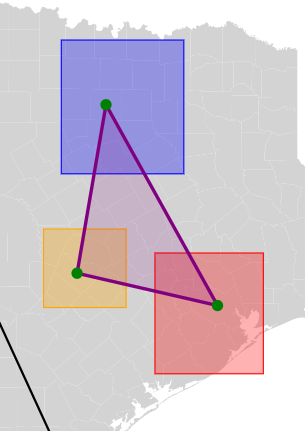
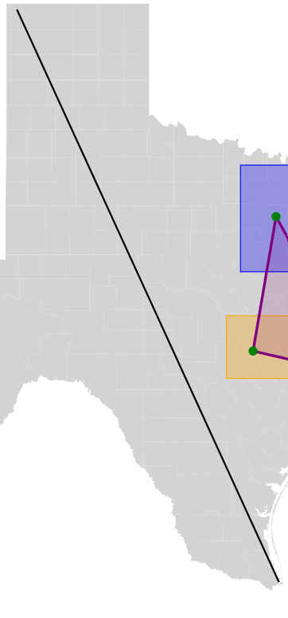

Assignment 1 - Hello World: GitHub and d3  

I created a Visuzalization map of Texas broken up into Counties using a GeoJson file to add points of interest to the map.

It includes the Metro Areas (Rectangles), with the center of the county from official Texas data as accompanying data points.

Pictured above is also the Texas Triangle connecting the most populous counties in Texas.

It also includes a line between two extreme points in Texas:

Link to Github Pages
https://macerritosz.github.io/a1-ghd3/

Technical Achievement :

Successfully Loaded the GeoJson file into visualization.

Design Achievement:

Was able to use the map to color code the texas metropolian areas on the Rectangles.
Was able to successfully layer without deleting important points.
